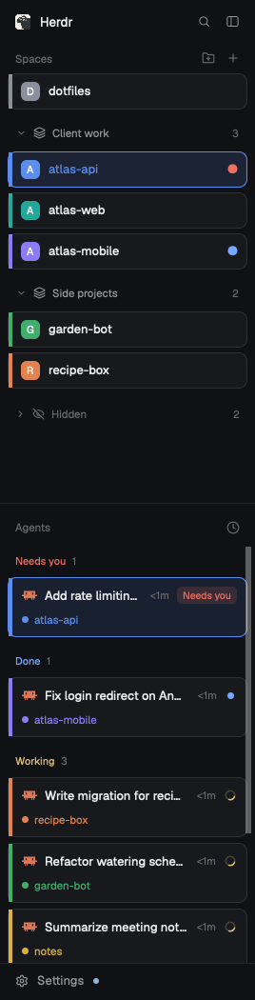

# Herdr Cards

A [Herdr](https://herdr.dev) layout that turns spaces and agents into color-coded
cards. You can group spaces, hide spaces or groups, and pick a color for each space.
Idle agents in hidden spaces are hidden too.

**To install:** ask your Herdr agent to add this repo as a layout. To build it from
scratch instead, see [RECIPE.md](RECIPE.md).

**Contents:**
- `layouts/cards.json`: the layout.
- `mods/space-cards`: the Spaces list, with groups, hiding and color picking.
- `mods/agent-cards`: the Agents list as cards.
