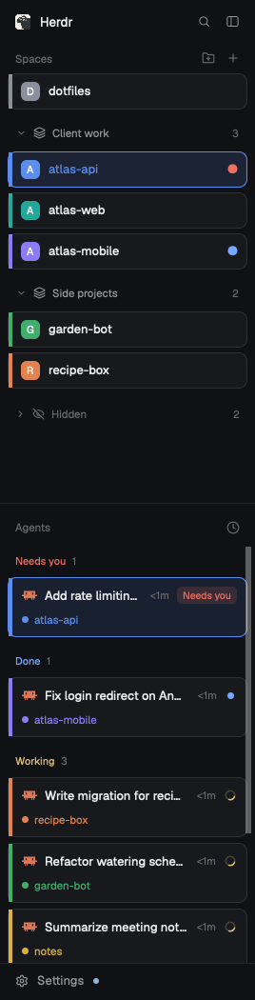

# Cards

A sidebar where spaces and agents are color-coded cards. Each space has a
color, and every agent card carries its space's color, so you can tell at a
glance which project an agent belongs to. Spaces can be put in groups and
hidden. Idle agents in a hidden space disappear, while agents that are
working, blocked or have unseen results stay visible.

## What you see

- **Sidebar (268px, `chrome` background), top to bottom:** the brand bar
  (46px), the Spaces list and the Agents list (equal weights, 90px minimum
  each), and the footer (69px). The work area to the right is the same as
  Herdr's `main` layout: tabs (42px), the active tab's panes with a 30px
  header, a hidden Files/Changes panel (368px) and the status bar (28px).
- **Space colors:** six palette colors `#22a99a` (ansi6), `#e3814f` (ansi3),
  `#5b8def` (ansi4), `#8b7cf6` (ansi5), `#3fae6a` (ansi2), `#d9649a` (ansi1),
  plus two extra colors you can pick: `#d9b23f` and `#8a919c`.
- **Spaces header (31px):** "Spaces", then a folder-plus button (New group)
  and a + button (New space).
- **Space card:**
  - Layout: rounded 9px, 1px border, with a 4px stripe in the space color on
    the left. Inside is a 20px tile (rounded 6px) in the space color with the
    space's first letter in white bold 11px, then the name, then the branch
    in dim text.
  - Active: the border is the space color and the background is that color
    at alpha `26`.
  - Hover: the background takes alpha `14` and the border alpha `99`.
  - Worktree spaces: indented 14px, with a branch icon in the space color
    instead of the tile.
  - A space that needs you shows a status dot on the right.
- **Group header:**
  - A fold chevron, a layers icon, the group name and the member count on
    the right.
  - When folded, it shows a dot if a member needs you.
  - On hover, an eye button hides the group.
- **Hidden section:** a folded section at the bottom with an eye-off icon,
  "Hidden", a needs-you dot and a count. It lists the hidden groups (each
  with a Show button), then the hidden spaces at opacity 0.55.
- **Agent card:**
  - Layout: rounded 9px, 1px border, 4px stripe in its space's color, with
    6px between cards.
  - Content: the agent icon, title, age and a status badge on the first row.
    The second row has a 7px dot in the space color and the space name.
  - Sub-agents appear inside their parent's card.
  - The focused card has a border in the space color and a background at
    alpha `1f`.
- **Agent group headers:** Needs you, Working and Idle. In grouped-by-space
  mode, the header shows the space dot.
- **Narrow sidebar:** under 160px, both lists become a rail. Agents show a
  3px color bar.

## How it behaves

- **Agent statuses:**
  - blocked: a red "Needs you" badge.
  - done: a filled dot in the space color, meaning finished but not seen yet.
  - working: a spinner.
  - idle: a hollow ring.
- **Right-click a space** to open a menu:
  - **Top row:** the label "Color" followed by eight color dots. The current
    color has a 2px ring. Click a dot to recolor the space; its card and
    its agents change color.
  - **Items:** Rename, New/Open/Remove worktree (only inside a git checkout),
    Move to `<group>` (one per other group), New group with this space,
    Remove from `<group>`, Hide/Show space and Close.
  - **Keys:** up and down move the selection, enter picks, escape closes.
- **Right-click a group header:** Rename group, Hide/Show group, New group,
  and Delete group (its spaces stay, ungrouped).
- **New group and Rename group** open a small dialog with a text field and a
  Save button. Enter saves.
- **Drag a space** onto a group header, or onto any space inside a group, to
  move it into that group. The header gets an accent border while you drag
  over it. Dragging inside a list reorders spaces as usual.
- **Hiding:** click the eye button that appears on hover, or use the menus.
  - A hidden space or group moves into the Hidden section. Click a group's
    Show button there to bring it back.
  - The active space stays in its place, dimmed, even when it's hidden.
  - A worktree space follows its repo's group and hidden state unless it has
    its own.
- **Agents in hidden spaces:**
  - Hidden once they're idle.
  - Stay while working or blocked, while their results are done but not yet
    seen, and while pinned or focused.
- Fold states of groups and of the Hidden section are kept per window
  (`localStorage` keys "groups.folded" and "hidden.open").

## Built from

- **Layout `cards`:** a clone of the shipped `main` layout. Block `spaces` →
  mod `space-cards`, block `agents` → mod `agent-cards`. The other blocks use
  shipped mods: `workspace-chrome` (brand bar, and footer with
  `props: {footer: true}`), `tabs`, `pane`, `files`, `changes` and
  `workspace-status`.
- **`space-cards`:** a clone of the shipped `spaces` mod.
  - It still assigns colors to new spaces in shared `"space.colors"`
    (`{spaceId: "ansi6" | … | "#rrggbb"}`), choosing the least-used palette
    color. The right-click color row writes the same key.
  - `organize.js` reads and writes shared `"space.organize"`:
    `{groups: [{id, name, hidden}], member: {spaceId: groupId}, hidden: [spaceId]}`.
  - Each render publishes shared `"space.hiddenNow"`, the sorted ids of every
    hidden space (worktrees included), and writes it only when it changes.
  - The menu and the name dialog are this same mod opened with
    `openOverlay({mod: "space-cards", kind: "popup" | "dialog", props: {menu} | {ask}})`.
    `render` branches on `props()`.
  - It uses `spaces`, `panes`, `machines`, `run` (`space.rename`,
    `space.close`, `space.new`), `openOverlay`, `closeOverlay`, `shared`,
    `setShared` and `watchFolder`.
  - It runs `git rev-parse`/`git status` for worktree items and branch
    names, and `hc machine ls` for remote machines. The shipped `spaces` mod
    does the same.
  - Icons: `eye.svg` and `eye-off.svg` (lucide).
- **`agent-cards`:** a clone of the shipped `agents` mod. It only reads
  `"space.colors"` and `"space.hiddenNow"` and never writes either. It
  filters with `pinned || focused || !hidden.has(space) || rank > idle`, where
  rank is `{blocked: 4, done: 3, working: 2, idle: 1}`.

## Watch out

- Only `space-cards` may write `"space.colors"`. If another mod writes
  anything other than a palette name or `#hex` string, the spaces list breaks
  with "not a function".
- A gpui color must be a theme color, `#rgb`, `#rrggbb` or `#rrggbbaa`.
  `"transparent"` fails to render; use the background color instead.
- The space menu popup is 270px wide so all eight color dots fit. At 240px,
  the last one is cut off.
- If you switch to a layout without `space-cards`, `"space.hiddenNow"` stays
  at its last value. Nothing clears it until `space-cards` renders again.
- The `~` home space gets no color assigned and shows the default ansi6 until
  you pick one.

## Done when

- `herdr-app check mods/space-cards` and `herdr-app check mods/agent-cards`
  pass, and `layout.switch {"name": "cards"}` shows both lists as cards with
  matching colors.
- Right-clicking a space shows the Color row. Picking a dot changes that
  space's card and its agents' color, and the menu closes.
- New group with this space, then hiding that group, moves the group under
  Hidden. An idle agent in that space disappears from Agents, and a working
  agent in it stays.
- Deleting a group keeps its spaces, now ungrouped.
